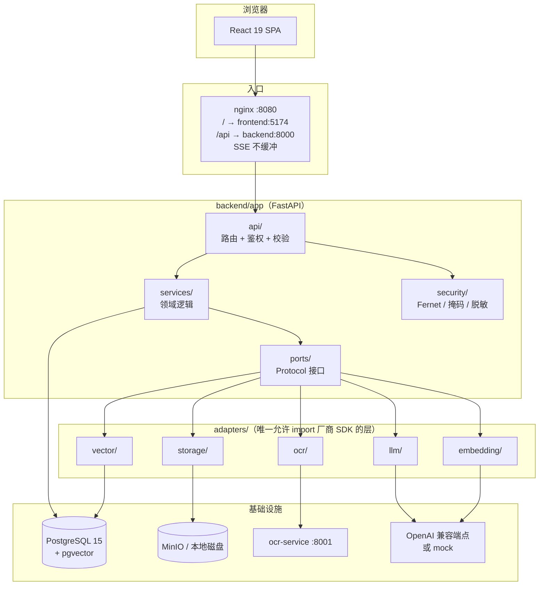

# LearnRise 学习竞赛平台

以「团队竞赛」为组织方式的学习闭环：**建赛 → 上传资料 → 知识库 → 结构化笔记 → 智能出题 → 间隔复习 → 学习助手 → 排行榜**。

同一套业务代码与云厂商解耦：领域层只依赖 `ports/` 里的 Protocol，具体实现放在 `adapters/`，
因此可以在本地 Docker（零外部依赖）与云端托管服务之间切换，而不改动业务逻辑。

---

## 当前状态

> **迁移中（in progress）**。本仓库正在从两套独立工程合并为单一仓库，请以本节为准判断可用性。

| 部分 | 状态 |
|---|---|
| 后端（FastAPI） | ✅ 全部纵向切片已并入；容器内测试全绿：**468 collected / 460 passed / 8 skipped / 0 failed** |
| 编排（Docker Compose / nginx） | ✅ 单套 compose，6 个服务全部 healthy；SSE 已确认不被缓冲 |
| API 契约与文档 | ✅ `openapi.json` + `docs/api/` 由脚本生成，可零漂移复现（61 个 path / 69 个 operation） |
| 前端（React） | ✅ 所有页面都读 FastAPI；本地 mock 层（`src/api/mock/`）已删除 |
| 前端功能对齐 | ✅ 本轮前端待办已全部补齐（Agent 设置 / 资料库 / 仪表盘 / 刷题 / 知识点讲解 / 思维导图真数据 / 陪练闭环 / 其余入口），个人中心设置与排行榜均已接真实数据；已知限制：深色模式下部分颜色仍为硬编码，未做完整主题适配 |
| 竞赛 / 学习助手 / 试炼 / 诊断 / 个人中心 / 排行榜 | ✅ 接口与页面均已落地并接通真实数据 |
| 演示数据 | ✅ `backend/scripts/seed_demo.py` 幂等写入 2 场竞赛、题目、错题与复习卡片 |
| 华为云适配器 | ⛔ **未实现**，仅保留 `ports/` 抽象与 `PROVIDER_PROFILE` 开关位 |

没有「已上线」的部署：本仓库当前只保证**本地 Docker 全链路可运行**。

本轮竞赛人数上限（`capacity`）不做强制校验：`capacity=null` 视为不限人数，界面显示「不限」。

---

## 待办事项（Roadmap）

> 后端接口已完整覆盖存量项目（63 个端点 / 23 张表 / 468 collected 测试）。下列前端补齐项**本轮已全部完成**，保留为交付核对清单；后续新增入口仍按此优先级维护。

### 前端补齐（按优先级）

- [x] **P0 · Agent 设置页** —— `/api/agents` 的 7 个端点（列表 / 新建 / 详情 / 修改 / 设默认 / 删除 / 测试连接）已有界面入口；知识点讲解与「默认 Agent」选择也已接通。
- [x] **P0 · 资料库页** —— `GET /api/sources`、`GET /api/sources/{id}`、`POST /api/sources/{id}/reprocess`、`GET /api/sources/{id}/tree`、`POST /api/sources/{id}/notes` 均可在 `/library` 浏览、重处理与查看知识点树。
- [x] **P1 · 仪表盘** —— `GET /api/dashboard/summary`（到期数 / 热力图 / 掌握度雷达 / 遗忘曲线 / 难度分布）已有 `/dashboard` 页面。
- [x] **P1 · 刷题页** —— `/api/quiz/generate`、`/api/quiz/{id}/answer`、`/api/quiz/{id}/attempts` 已有 `/quiz` 入口，与 `/trial` 考试区分。
- [x] **P1 · 知识点讲解** —— `POST /api/knowledge-points/{id}/explain`（SSE 流式 + 风格选择 + Agent 选择）已在 `/kp/:id` 提供入口。
- [x] **P1 · 思维导图接真数据** —— `MindMapPanel` 已改为消费 `/api/sources/{id}/tree` 与 `/api/sources/{id}/notes` 的真实数据。
- [x] **P2 · 陪练闭环前端** —— `/api/assistant/practice/sessions`（创建 / 作答 / 进度 / 结束）已有 `/practice` 页面。
- [x] **P2 · 其余入口** —— `POST /api/assistant/exam-plan`、`POST /api/competitions/{id}/plan/generate`、`GET|POST /api/review/cards`、`GET /api/knowledge-points/search` 与 `PUT|DELETE /api/knowledge-points/{id}`、`POST /api/assistant/conversations/{id}/messages` 均已有界面入口。

### 已完成（本轮）

- [x] 苏格拉底引导模式 + 「揭晓答案」按钮（`a39a048`）
- [x] 移除 mock 层与死契约，全部页面直连 FastAPI（`47accc2`）

### 补齐时必须遵守

- **受保护端点**：上述端点现已全部接入前端，清理死契约时**禁止删除**（另有 `/health`、`/files/{path}`、`/internal/reminders/run` 为基础设施端点，不面向用户界面）。
- **新增页面**需补 Playwright 用例与截图证据（沿用 `frontend/e2e/` 与仓库外 `.sisyphus/evidence/` 的惯例）；`.vue` 文件禁止入仓。
- **大文件**：新增大文件需在 `scripts/check_repo_hygiene.sh` 的 `ALLOWED_OVERSIZE` 登记，否则卫生闸门失败。
- **契约生成物**：改后端字段必须重跑 `scripts/gen_api_docs.py`，否则 CI 的 docs-drift 任务失败。

### 其他

- [ ] 华为云适配器（OBS / MaaS / OCR / FunctionGraph）—— 本轮明确不实现，仅保留 `ports/` 抽象与 `PROVIDER_PROFILE` 开关。

---

## 技术栈

| 层 | 选型 |
|---|---|
| 前端 | React 19 + TypeScript + Vite 6 + Tailwind CSS 4 + React Router 7 |
| 后端 | FastAPI + SQLAlchemy 2 + Alembic + Pydantic v2 |
| 数据库 | PostgreSQL 15 + pgvector（`chunks.embedding` 1024 维 + HNSW） |
| OCR | 独立容器，RapidOCR（PP-OCR ONNX 模型）经 HTTP 调用 |
| 反代 | nginx（`/` → Vite dev server，`/api` → FastAPI，SSE 关闭缓冲） |
| 编排 | 单套 Docker Compose（`docker-compose.yml`，project `learnrise`） |

---

## 架构



依赖方向固定为 **`api → services → ports ← adapters → 外部服务`**。
业务层永远不 import 具体 SDK；`scripts/check_import_isolation.sh` 会机械地守住这条边界。

---

## 目录结构

```
backend/            FastAPI 应用（Python 3.11，容器内运行）
  app/api/          路由层：按模块自动发现，router 自带 prefix/tags
  app/services/     领域逻辑（纯函数优先）
  app/models/       SQLAlchemy 模型
  app/ports/        对外部能力的 Protocol 定义
  app/adapters/     唯一允许出现厂商 SDK 的目录（llm/embedding/vector/storage/ocr）
  app/security/     加密、掩码、日志脱敏
  app/worker/       定时任务（APScheduler）
  alembic/          数据库迁移（versions/0001…0004）
  tests/            unit / services / api / contracts 四层
  scripts/          种子数据与运维脚本
frontend/           React 19 + Vite 单页应用
  src/api/          请求层（全部走 FastAPI）
  src/assets/       静态演示数据（思维导图等非接口内容）
  src/pages/        页面
  src/components/   组件（layout / competition / create / plan / prep / ui）
ocr-service/        RapidOCR HTTP 服务（独立镜像）
deploy/             nginx 配置、Web 镜像、systemd 单元
docs/               架构、部署、复现、限制等文档
docs/api/           由 OpenAPI 生成的接口文档（勿手改）
scripts/            CI 闸门、API 文档生成、演示与运维脚本
fixtures/           演示用 PDF / 图片（合成数据）
```

---

## 快速开始

前置：Docker + Compose v2 以上，约 8 GB 内存、3 GB 磁盘。

```bash
# 1) 启动全部服务（db / minio / backend / ocr-service / frontend / nginx）
docker compose up -d --build

# 2) 等健康检查变绿（6 个服务都应是 healthy）
docker compose ps

# 3) 写入演示数据（幂等，可重复执行）
docker compose exec -T backend python scripts/seed_demo.py
```

> **首次启动（或数据库用户/库名变更后）必须先 `docker compose down -v`。**
> PostgreSQL 的数据目录不会自动应用新的 `POSTGRES_USER` / `POSTGRES_DB`，
> 复用旧卷会导致后端启动即报认证失败。

后端容器启动时会自动执行 `alembic upgrade head`，无需手工迁移。

### 访问地址

| 服务 | 地址 |
|---|---|
| Web（经 nginx） | http://localhost:8080 |
| Vite dev server | http://localhost:5174 |
| API 文档（Swagger） | http://localhost:8000/api/docs |
| 健康检查 | http://localhost:8000/api/health |
| OCR | http://localhost:8001/health |
| MinIO 控制台 | http://localhost:19001（`minioadmin` / `minioadmin`） |
| PostgreSQL | `localhost:55433`（`learnrise` / `learnrise`） |

演示账号：`demo@example.com` / `demo1234`（仅本地，由种子脚本写入）。

### 演示数据与端到端测试

`seed_demo.py` 是**唯一的幂等种子入口**：重复执行不会新增重复行。它写入演示用户、
Agent、2 场演示竞赛（一场归演示用户所有并带邀请码，一场以 `member` 身份加入）、
6 个知识点、8 道题目、若干错题尝试与到期复习卡片，使 `/api/wrong-questions`、
`/api/review/due` 与 `/api/trial/exams` 开箱即有内容。

```bash
# 幂等种子（连跑两次，用户/竞赛/题目数量不变）
docker compose exec -T backend python scripts/seed_demo.py

# 前端端到端冒烟（需要 nginx :8080 + backend :8000 已启动）
cd frontend
E2E_CHROMIUM_PATH=/path/to/chrome \
E2E_BASE_URL=http://localhost:8080 \
E2E_API_URL=http://127.0.0.1:8080 \
npx playwright test e2e/smoke.spec.ts
```

冒烟用例以演示用户登录，依次访问首页、竞赛详情、`/prep`、`/trial`、`/rank`、
`/profile`、`/review`，断言页面不再停留骨架屏、控制台没有未捕获异常；试炼页还会
提交一次答案以验证服务端判分与逐题解析。设置 `EVIDENCE_DIR` 可把截图写到仓库外。

---

## 常用命令

```bash
make up            # docker compose up -d --build
make down          # 停止并移除容器（保留卷）
make logs          # 跟随日志
make test          # 容器内跑后端全量 pytest
make lint          # 容器内跑 ruff + mypy
make migrate       # alembic upgrade head
make demo          # 幂等写入演示用户、竞赛、错题与复习卡片
make compose-check # 校验 compose 文件可解析
```

`make verify` 是提交前的一站式门禁：三道闸门 + ruff + mypy + 容器内 pytest（并对基线做回归比对）
+ 前端 `tsc --noEmit` 与 `vite build` + gitleaks。它**要求工作区已提交干净**（最后一步会校验
`git status` 为空），因此请在 `git commit` 之后运行。

> 后端测试**必须**在容器内运行：宿主机 Python 版本与本项目固定的 3.11 不一致，
> 且测试直接连接数据库。请使用 `docker compose run --rm backend pytest -q`。

测试基线记录在 `scripts/test-baseline.json`：`passed` 只允许增加，`skipped` 只允许减少，
`failed` / `errors` 必须为 0。任何存量断言的变更都要在任务行与提交正文里登记理由。

手工复核命令：

```bash
cd frontend && npm run typecheck && npm run build
docker compose run --rm -T backend ruff check app tests alembic
docker compose run --rm -T backend mypy app
docker compose run --rm -T -v /tmp:/out backend pytest -q --junitxml=/out/junit.xml
bash scripts/compare_test_baseline.sh /tmp/junit.xml
```

---

## API 文档

- **契约真源**：FastAPI 应用本身 → `openapi.json`（仓库根，由脚本导出）。
- **生成文档**：`docs/api/*.md`，按 tag 分文件，每个端点含鉴权、请求/响应字段表、错误码与 curl 示例。
- **生成物禁止手改**：每个生成文件头部都有 `GENERATED BY scripts/gen_api_docs.py — DO NOT EDIT`。

重新生成（幂等，连跑两次 `git diff` 应为空）：

```bash
docker compose run --rm -v "$PWD:/repo" -w /repo backend python scripts/gen_api_docs.py
```

- 新端点的统一规范见 [`docs/api/conventions.md`](docs/api/conventions.md)：错误体 `{code, detail}`、
  分页 `limit`/`offset` + `X-Total-Count`、时间 ISO-8601、越权一律返回 404 而非 403。
- 存量端点保持路径、状态码与 `detail` 文案逐字不变（`code` 只作为新增字段出现在新端点上）。

### 接口分组

| 分组 | 路径前缀 | 主要内容 |
|---|---|---|
| 竞赛 | `/api/competitions` | 列表 / 详情 / 成员 / 邀请码 / 学习规划 / 计划生成 |
| 学习助手 | `/api/assistant` | 会话、RAG 流式回复、引用揭示、薄弱点与补强计划、苏格拉底模式 |
| 试炼 | `/api/trial` | 开始考试、提交答案、读取考试状态（服务端判分） |
| 诊断 | `/api/wrong-questions`、`/api/dashboard` | 错题分页筛选、仪表盘汇总 |
| 个人中心 | `/api/profile` | 资料、统计、参赛记录、学习进度、设置项 |
| 排行榜 | `/api/leaderboard/{competition_id}` | 竞赛内连续名次与积分 |
| 上传与资料 | `/api/sources`、`/api/uploads`、`/api/jobs` | 文档上传 / 解析任务、奖励图片上传 |
| 复习 / 练习 / 计划 | `/api/review`、`/api/practice`、`/api/exam-plan` | DSR 到期队列与评分、自适应练习、备考计划 |

以上接口全部由 FastAPI 唯一实现；前端不再有按域切换的 mock 注册表。华为云适配器仍未实现，
当前可运行的只有本地 Docker profile。

---

## 质量闸门

三道机械闸门，均已注册到 `.pre-commit-config.yaml`：

| 脚本 | 作用 |
|---|---|
| `scripts/check_legacy_name.sh` | 旧项目名零残留：内容、文件名、二进制、分支名、提交信息五类扫描 |
| `scripts/check_repo_hygiene.sh` | 工作区必须干净；diff 在白名单内；不跟踪 `node_modules/.venv/dist/var`；仓库内只有一个 `.git`；无未申报的大文件 |
| `scripts/check_import_isolation.sh` | 厂商 SDK（华为云 / openai / boto3 / minio / obs）只允许出现在 `backend/app/adapters/` 内 |

```bash
bash scripts/check_legacy_name.sh
bash scripts/check_repo_hygiene.sh
bash scripts/check_import_isolation.sh
```

---

## 环境变量

- 完整模板：[`.env.example`](.env.example)（接真实模型时使用）。
- 离线演示档：[`.env.demo`](.env.demo)（默认 `mock` provider，**零 Key 即可跑通全链路**）。

`mock` 是确定性的离线实现（同一输入同一输出、不联网），用于演示与测试；
返回体的 `model` 字段会明确标注 `mock-local`，不会伪装成真实模型。

`.env` 已被 `.gitignore` 忽略，**任何密钥都不要写进仓库**。

---

## 贡献

提交规范、提交粒度、生成物处理与提交前检查见 [`CONTRIBUTING.md`](CONTRIBUTING.md)。
要点：Conventional Commits；一次提交只做一件事；重命名与逻辑改动分开提交；依赖变更单独提交。

---

## 文档索引

| 文档 | 内容 |
|---|---|
| [`docs/architecture.md`](docs/architecture.md) | 分层、依赖倒置、数据流、SSE、安全模型 |
| [`docs/api/README.md`](docs/api/README.md) | 接口文档的生成方式与预览方法 |
| [`docs/api/conventions.md`](docs/api/conventions.md) | 新端点的错误码、分页、鉴权与题型映射约定 |
| [`docs/deploy.md`](docs/deploy.md) | 部署手册（ECS / 数据库 / 对象存储 / nginx / 证书） |
| [`docs/privacy.md`](docs/privacy.md) | 数据脱敏与隐私边界 |
| [`docs/limitations.md`](docs/limitations.md) | 已知偏差、替代实现与未验证项 |
| [`docs/scope.md`](docs/scope.md) | 范围冻结与演示脚本 |
| [`docs/repro.md`](docs/repro.md) | 可复现性记录（只写真实执行过的结果） |
| [`docs/parity-report.md`](docs/parity-report.md) | 双 profile 契约对比结果 |
| [`docs/functiongraph.md`](docs/functiongraph.md) | 定时触发器与签名内部端点契约 |

---

## 许可与数据

`fixtures/` 内为合成演示数据，不含真实个人信息。运行时不抓取用户数据；
上传文件只写入配置的对象存储。隐私策略见 [`docs/privacy.md`](docs/privacy.md)。
