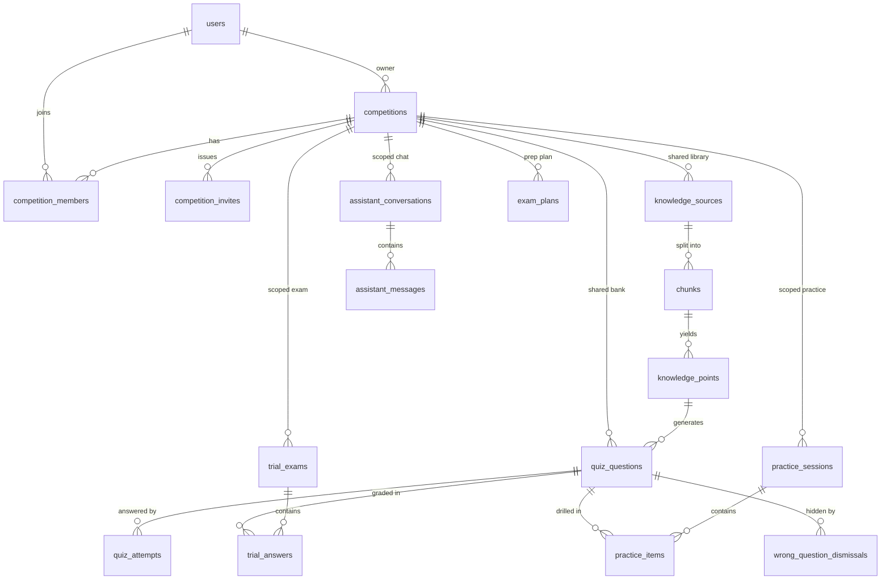

# 竞赛域数据模型（ERD）

本文件描述平台域新增的关系模型、两层数据归属（竞赛级共享库 / 个人私有）与权限模型。
实现见 `backend/app/models/`，建表迁移见 `backend/alembic/versions/0005_platform_domain.py`。

---

## 1. 实体关系



---

## 2. 表清单

| 表 | 归属 | 说明 |
|---|---|---|
| `competitions` | 共享 | 竞赛本体：标题、描述、简介、题型（JSONB）、起止时间、奖励图、规划状态 |
| `competition_members` | 共享 | 成员与角色（`leader` / `member` / `viewer`），`(competition_id, user_id)` 唯一 |
| `competition_invites` | 共享 | 邀请码（全局唯一）、使用次数上限、过期时间 |
| `trial_exams` | 个人 | 试炼考试实例：**固化题目 id 与顺序**，`expires_at` 控制过期，`status` ∈ `in_progress/submitted/expired` |
| `trial_answers` | 个人 | 逐题作答与判分结果，`(exam_id, question_id)` 唯一 → 重复提交幂等 |
| `assistant_conversations` | 个人 | 学习助手会话，可选绑定 `competition_id`（共享库）与 `mode` |
| `assistant_messages` | 个人 | 消息与引用（`citations` JSONB），`role` ∈ `user/assistant` |
| `practice_sessions` | 个人 | 陪练会话：当前难度、答题数、正确数、状态 |
| `practice_items` | 个人 | 会话内题目：`(session_id, question_id)` 与 `(session_id, position)` 双唯一 → 会话内不重复出题 |
| `wrong_question_dismissals` | 个人 | 错题软隐藏，`(user_id, question_id)` 唯一 |
| `exam_plans` | 个人 | 备考计划快照：`mode` ∈ `standard/sprint`，`items` JSONB |

### 既有表的新增列

| 表 | 新列 | 语义 |
|---|---|---|
| `knowledge_sources` | `competition_id`（可空） | 非空 = 竞赛共享库资料；NULL = 个人资料 |
| `quiz_questions` | `competition_id`（可空） | 同上，用于共享题库 |
| `chunks` | `competition_id`（可空） | 冗余列，仅用于 HNSW 检索时**直接过滤**，避免 JOIN |

三列均为 `ON DELETE SET NULL`：删除竞赛不会连带删除资料/题目，只会让它们退回个人可见。
既有 12 张表的列名、类型、约束**零变化**（只新增上述三列），存量行全部为 `NULL`。

---

## 3. 两层归属

```
competition_id IS NULL  →  个人私有（仅本人可见、可写）
competition_id NOT NULL →  竞赛共享（按成员角色判定读/写）
```

- 共享是 **opt-in**：默认不共享，必须显式把资料/题目绑定到某个竞赛。
- 个人数据（错题、复习、掌握度、会话、考试、陪练）**永远仅本人可见**，即使同队也不行。
- 越权一律返回 **404**（不是 403），与存量 `require_owner` 约定一致：不泄露资源是否存在。

---

## 4. 权限矩阵（本计划采用的假设）

| 角色 | 读共享库 | 上传资料 | 建题 | 管理成员 | 改竞赛 | 删共享内容 |
|---|---|---|---|---|---|---|
| `leader` | ✅ | ✅ | ✅ | ✅ | ✅ | ✅ |
| `member` | ✅ | ✅ | ✅ | ❌ | ❌ | ❌ |
| `viewer` | ✅ | ❌ | ❌ | ❌ | ❌ | ❌ |
| 非成员 | ❌（404） | ❌（404） | ❌（404） | ❌（404） | ❌（404） | ❌（404） |

建赛者自动成为 `leader`；邀请码加入者默认为 `member`。

---

## 5. 题型存储

`competitions.question_types` 使用 **JSONB 数组**（可用 `?|` 操作符查询），不建子表。
取值必须受限，与后端 `QuizType = Literal["choice", "judge", "short_answer"]` 对齐：

| 前端取值 | 后端落库 | 语义 |
|---|---|---|
| `multiple` | `choice` | 多选按选项**集合**判分（忽略顺序） |
| `blank` | `short_answer` | 文本规范化后比对 |
| `both` | 拆成两条 | 一道 `choice` + 一道 `judge` |

未知题型**必须报错**，禁止静默丢弃。

---

## 6. 不变量

1. `practice_items` 的 `(session_id, question_id)` 唯一 → 一次陪练内不重复出题。
2. `trial_answers` 的 `(exam_id, question_id)` 唯一 → 重复提交不重复计分。
3. `competition_members` 的 `(competition_id, user_id)` 唯一 → 同一竞赛内角色唯一。
4. 陪练单会话上限 50 题（`PRACTICE_MAX_ITEMS`），超出返回 `409 SESSION_LIMIT`。
5. `exam_plans.items` 中所有日期 `<= competitions.end_at`。
6. 删除竞赛级联清理成员/邀请码/考试/会话/陪练/计划；资料与题目退回个人（`SET NULL`）。
